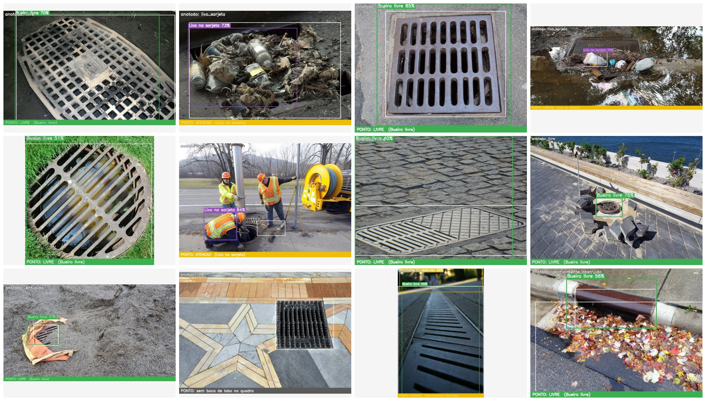

# Boca de Lobo · componente Visão (Applied Computer Vision)

> **GS 2026.2 · CitizenTech · Engenharia de Software 4º ano · FIAP**

Antes de cada temporal, um robô inspeciona as bocas de lobo do bairro e descobre quais estão entupidas.
Este repositório é o **olho do robô**: um detector YOLOv8 treinado de forma customizada que olha a imagem
da câmera, em tempo real, e diz se o ponto tem **bueiro livre**, **parcialmente obstruído**, **entupido**
ou **lixo acumulado na sarjeta**. Essa leitura segue para o pipeline de dados do produto, que cruza com a
previsão de chuva e as áreas de risco e avisa a equipe de limpeza e os moradores.

**Documento da entrega (PDF): [documento/Documento_Visao_BocaDeLobo.pdf](documento/Documento_Visao_BocaDeLobo.pdf)**

**Vídeo de demonstração (53 s): [resultados/demo/demo_ronda.mp4](https://github.com/FelipeVoidela/GS2-2026-Applied-Computer-Vision/raw/main/resultados/demo/demo_ronda.mp4)**.
O GitHub não toca vídeo guardado no repositório: o link baixa o arquivo (17 MB). A prévia abaixo mostra os 4 primeiros
pontos da ronda, um de cada classe anotada: o modelo acerta o bueiro livre, acusa obstrução nos dois bueiros obstruídos
(trocando o grau: lê o parcial como entupido e o entupido como parcial) e não vê o lixo na sarjeta.


## Integrantes

| Nome completo | RM |
|---|---|
| Açussena Macedo Mautone | 552568 |
| Felipe Heilmann Marques | 551026 |
| Felipe Voidela Toledo | 98595 |
| Carlos Eduardo Caramante Ribeiro | 552159 |
| Ian Cancian Nachtergaele | 98387 |

## Ficha técnica

| Item | Boca de Lobo |
|---|---|
| Nome do produto | Boca de Lobo |
| Cidadão e território | Morador de bairro que alaga todo verão, principalmente em áreas baixas e periféricas de São Paulo |
| Problema, em uma frase | Bueiro entupido + chuva forte = rua alagada, carro perdido e casa invadida, e ninguém avisa antes |
| Proposta de valor | Saber antes da chuva quais bueiros estão entupidos em área de risco: a equipe de limpeza recebe a rota priorizada, e o morador sabe onde não passar e o que fazer |
| O que a visão resolve | O sensor de ultrassom do robô mede a profundidade da sarjeta, mas não sabe se o que está ali é folha, lixo ou asfalto. A câmera com o YOLO enxerga a grelha e classifica o ponto em 4 estados, na hora, sem depender de alguém olhar foto por foto |
| Componentes do produto | Robô (Maker Lab) · **YOLO (Visão, este repo)** · assistente com RAG e agente (GenAI) · pipeline de dados (Big Data) · bot de alertas (RPA) · mapa público com observabilidade (DevOps) · modelo de negócio (BI) |
| Fontes de dados | 296 fotos reais de licença livre, do Wikimedia Commons e do Flickr (autor e licença de cada uma em [dados/fontes.csv](dados/fontes.csv)), anotadas neste projeto; mais imagens sintéticas usadas só no treino |
| Modelos de IA | `yolov8n-bocadelobo-v2`: YOLOv8n (3 milhões de parâmetros, 6 MB) treinado por transferência de aprendizado a partir do COCO. Grounding DINO só como apoio à anotação; CLIP só em um experimento. Tudo roda local, em CPU |
| URL do MVP e repositório | Mapa do cidadão: https://felipevoidela.github.io/GS2-2026-Big-Data-Architecture/ · Este repositório: https://github.com/FelipeVoidela/GS2-2026-Applied-Computer-Vision |
| Indicadores de impacto | Acerto da leitura do ponto; bueiros com problema que passam sem alerta; quadros por segundo no hardware do robô |
| ODS | 11 (cidades resilientes), 13 (adaptação ao clima), 3 (saúde); a contribuição de cada um está logo abaixo |

**Como a visão contribui para os ODS**

* **ODS 11, meta 11.5** (menos pessoas afetadas por desastres, inclusive os relacionados à água): a leitura
  automática de cada boca de lobo é o dado que permite limpar antes da chuva os pontos críticos em área de risco.
* **ODS 13, meta 13.1** (resiliência e adaptação a riscos do clima): com chuvas fortes mais frequentes,
  inspecionar o bairro inteiro a cada ronda só é viável se a classificação for automática e em tempo real.
* **ODS 3, meta 3.3** (combate a doenças transmitidas pela água): menos água parada e menos enchente
  significam menos contato com água contaminada (leptospirose) e menos criadouros de mosquito.

## Resultado

Modelo `yolov8n-bocadelobo-v2`, avaliado nas **48 fotos reais de teste**, que ele não viu no treino
nem na escolha dos pesos ([resultados/teste/metricas.json](resultados/teste/metricas.json)):

| Classe | Caixas no teste | Precisão | Revocação | mAP@50 | mAP@50-95 |
|---|---|---|---|---|---|
| Bueiro livre | 33 | 0,882 | 0,680 | 0,787 | 0,499 |
| Parcialmente obstruído | 7 | 0,000 | 0,000 | 0,038 | 0,016 |
| Bueiro entupido | 2 | 0,000 | 0,000 | 0,000 | 0,000 |
| Lixo na sarjeta | 9 | 0,396 | 0,222 | 0,155 | 0,029 |
| **Média das 4 classes** | 51 | 0,320 | 0,226 | **0,245** | 0,136 |

| Leitura do ponto (uma foto, uma resposta) | |
|---|---|
| Acerto geral | 26 de 48 fotos (54,2%) |
| Bueiros livres lidos como livres | 23 de 33 (7 não foram vistos e 3 foram lidos como problema) |
| Bueiros obstruídos reconhecidos | **0 de 9** |
| Pontos com problema que geraram alerta | 4 de 15 (os 4 por lixo na sarjeta) |
| Velocidade | 30,2 ms por quadro, **33,1 quadros por segundo** em CPU (AMD Ryzen 5 5600X 6-Core Processor), sem GPU |

O que esses números dizem, sem arredondar para cima:

* **Funciona: encontrar a boca de lobo, em tempo real.** Na classe livre o mAP@50 é 0,787 e a precisão é de 88,2%:
  quando o modelo aponta uma grelha, quase sempre há uma. A revocação é de 68,0%: ele ainda deixa passar parte das
  grelhas de formatos, países e fotógrafos que o treino não viu. Roda a 33 quadros por segundo em um processador comum.
* **Não funciona: graduar a obstrução.** O modelo reconheceu 0 dos 9 bueiros obstruídos do teste. Ele acerta 124 das
  128 montagens sintéticas e 12 das 12 fotos reais obstruídas do próprio treino
  ([conferência](resultados/historico/rodada2_conferencia_treino.json)): decorou os poucos exemplos, sem aprender a
  obstrução como ela aparece em fotos novas. E quando a grelha está toda coberta, muitas vezes ele nem detecta que
  ali há um bueiro.
* **O teste cresceu e ficou mais difícil.** Até a segunda rodada eram 26 fotos, 4 delas com bueiro obstruído, e o
  acerto geral era de 19 em 26. O teste atual tem 48 fotos, de mais autores, e 9 com bueiro obstruído: os números são
  mais baixos e mais confiáveis.

Na versão atual, a visão serve para **localizar e contar as bocas de lobo** de uma ronda e confirmar as que estão
limpas; o estado do ponto (livre, atenção, crítico) deve continuar vindo do sensor de ultrassom do robô até o modelo
ser retreinado com fotos reais de bueiros obstruídos. A análise completa, as curvas de treino e os exemplos de acertos
e erros estão no [documento da entrega](documento/Documento_Visao_BocaDeLobo.pdf) e em [resultados/](resultados/).

### Três rodadas de treino e um experimento

O modelo entregue é o da **segunda rodada**. O que mudou em cada uma:

1. **Primeira:** as imagens sintéticas eram só montagens de lixo sobre a grelha, e o modelo aprendeu a reconhecer a
   colagem em vez da obstrução.
2. **Segunda (entregue):** lixo colado também **ao lado** de bueiros que continuam livres (para a marca da colagem
   deixar de denunciar a classe), colagem com borda mais nítida e repetição das fotos reais de bueiro obstruído.
3. **Terceira:** mais dado real. Buscas dirigidas a bueiro obstruído levaram o conjunto de 162 para 296 fotos reais,
   e as fotos reais de bueiro obstruído no treino, de 12 para 21.

Em cada troca, o critério foi fixado antes de treinar e usa só a **validação**. Para a terceira rodada: reconhecer
pelo menos dois bueiros obstruídos a mais que a segunda, ler como problema no máximo 10% dos bueiros livres e não
perder mais de cinco pontos percentuais de acerto nos livres.

As três rodadas nas **mesmas 26 fotos de validação e 26 de teste** das duas primeiras
([métricas](resultados/historico/)):

| Rodada | mAP@50 (validação) | Leituras certas (validação) | Problemas alertados (validação) | mAP@50 (teste) | Leituras certas (teste) | Problemas alertados (teste) |
|---|---|---|---|---|---|---|
| 1ª: só montagens sobre a grelha | 0,296 | 19 de 26 | 0 de 6 | 0,232 | 19 de 26 | 1 de 7 |
| **2ª: modelo entregue** | 0,352 | 21 de 26 | 1 de 6 | 0,242 | 19 de 26 | 3 de 7 |
| 3ª: mais fotos reais | 0,447 | 18 de 26 | 0 de 6 | 0,259 | 19 de 26 | 2 de 7 |

A segunda e a terceira na **validação e no teste ampliados** (48 e 48 fotos, que nenhuma das duas viu no treino):

| Rodada | mAP@50 (validação) | Leituras certas (validação) | Problemas alertados (validação) | mAP@50 (teste) | Leituras certas (teste) | Problemas alertados (teste) |
|---|---|---|---|---|---|---|
| **2ª: modelo entregue** | 0,353 | 35 de 48 | 4 de 13 | 0,245 | 26 de 48 | 4 de 15 |
| 3ª: mais fotos reais | 0,348 | 32 de 48 | 2 de 13 | 0,227 | 30 de 48 | 6 de 15 |

**A terceira rodada não cumpriu o critério.** Na validação ampliada ela reconheceu 0 dos 5 bueiros obstruídos (a
segunda, 1) e alertou menos pontos com problema. No teste acertou mais leituras, mas também sem reconhecer nenhum dos
9 bueiros obstruídos; somando validação e teste, as duas empatam (62 e 61 leituras certas em 96). Ela repete o
padrão da segunda: acerta 20 das 21 fotos reais obstruídas do próprio treino e nenhuma das novas. O modelo entregue
continua sendo o da segunda rodada; os pesos da terceira estão em `modelos/yolov8n-bocadelobo-v3.pt` para conferência.

**Experimento com CLIP como segunda etapa** ([scripts/10_experimento_clip.py](scripts/10_experimento_clip.py)): o YOLO
só localiza o bueiro e o CLIP, que já conhece "folhas" e "lixo" de um treino muito mais amplo, decide no recorte se
ele está obstruído. Nos recortes anotados o CLIP separa bem os dois casos mesmo sem treino (AUC de 0,90 no treino e
0,94 na validação). De ponta a ponta, com o limiar escolhido no treino, a leitura do ponto na validação não mudou
(1 de 5 bueiros obstruídos): parte deles o YOLO não detecta, então não há recorte para graduar, e parte fica abaixo do
limiar. Não foi adotado ([resultado](resultados/experimentos/clip_segunda_etapa.json)).

O ganho da terceira rodada ficou na medida, não no modelo: validação e teste quase dobraram, as fotos repetidas
entre as fontes saíram e a divisão passou a ser estável. O que falta para o modelo é o que as fotos públicas não
têm: em 1.374 fotos baixadas, pouco mais de trinta mostram um bueiro obstruído.



O vídeo de demonstração é uma **ronda simulada**: cada foto de teste vira alguns segundos de vídeo com movimento de
câmera, e o modelo roda em todos os quadros durante a gravação (19,8 quadros por segundo com detecção, painel e
codificação do vídeo juntos). Dos 16 pontos, 6 foram lidos como livres, 2 em atenção, 3 críticos e 5 ficaram sem
leitura. Com a câmera se aproximando, o modelo chega a acusar obstrução em bueiros que na foto parada ele lê como
livres: é um indício de que a distância pesa, não um resultado medido. Ainda não há filmagem do robô em campo;
para gravar com câmera de verdade, use `python detectar.py --fonte 0 --salvar demo.mp4`.

## Como funciona


1. **Fotos** de bocas de lobo, grelhas e sarjetas, de licença livre, baixadas do Wikimedia Commons e do Flickr.
2. **Pré-anotação** com Grounding DINO (detector que localiza o que uma frase descreve) e **revisão visual**
   de cada caixa proposta: uma das 4 classes ou descartar.
3. **Dataset YOLO** dividido em treino, validação e teste, sem fotos da mesma série em conjuntos diferentes.
4. **Treino customizado** do YOLOv8n, partindo dos pesos do COCO.
5. **Detecção em tempo real** na câmera do robô (`detectar.py`), com o estado do ponto na tela.
6. **Leitura enviada** ao pipeline de dados no formato do contrato (classe, confiança e `foto_id`).

### As 4 classes e o critério de anotação


| Classe (`visao.classe`) | Critério | Estado sugerido para o ponto |
|---|---|---|
| `livre` | Abertura desobstruída; no máximo sujeira leve (até cerca de 1/4 coberta) | livre |
| `parcialmente_obstruido` | Folhas, lixo ou terra cobrindo parte da abertura (entre 1/4 e 3/4) | atenção |
| `entupido` | Abertura quase toda coberta (mais de 3/4) ou tomada por lama | crítico |
| `lixo_sarjeta` | Lixo ou folhas acumulados na sarjeta, fora do bueiro | atenção |

Os nomes são exatamente os que a camada Prata do [pipeline de dados](https://github.com/FelipeVoidela/GS2-2026-Big-Data-Architecture)
aceita no campo `visao.classe`.

## Os dados

| | |
|---|---|
| Origem | **Wikimedia Commons** (categorias de bocas de lobo, sarjetas e grelhas, mais buscas por texto) e, na terceira rodada, **Flickr pelo Openverse**, com buscas dirigidas a bueiro obstruído ("blocked drain", "storm drain leaves", "bueiro entupido"...). 1.374 fotos baixadas: 614 do Commons e 760 do Flickr |
| Licenças | Só fotos de licença livre que permite redistribuir e modificar (CC BY, CC BY-SA, CC0, domínio público). Autor, licença e página de cada foto em [dados/fontes.csv](dados/fontes.csv) |
| Anotação | As buscas por texto trazem muito ruído (tampas, rios, pessoas), então as fotos do Flickr passaram por uma triagem antes. 1.066 caixas propostas pelo Grounding DINO e revisadas: 320 aceitas, mais 36 desenhadas à mão onde o detector não propôs nada. Decisões em [dados/anotacao/revisao.csv](dados/anotacao/revisao.csv) e [manuais.csv](dados/anotacao/manuais.csv) |
| Fotos repetidas | 25 fotos apareciam nas duas fontes (a mesma foto no Flickr e no Commons, uma delas do teste). [scripts/01c_achar_repetidas.py](scripts/01c_achar_repetidas.py) acha as cópias por assinatura da imagem e elas entram uma vez só |
| Conjunto final | 296 fotos reais e 350 caixas: 200 de treino, 48 de validação e 48 de teste. As 162 fotos das duas primeiras rodadas continuam no mesmo conjunto em que estavam ([divisao.csv](dados/anotacao/divisao.csv)) |
| Bueiros obstruídos reais | 36 fotos: 21 no treino, 6 na validação e 9 no teste (eram 12, 4 e 4) |
| Sintéticas | 184 imagens geradas por copiar e colar (lixo real colado em foto real de bueiro) e 63 repetições das fotos reais de bueiro obstruído, **só no treino**. Validação e teste são 100% fotos reais, sem repetição |

**Por que imagens sintéticas (justificativa):** nas fotos públicas, bueiro livre é comum e bueiro entupido é
raro, porque quase ninguém fotografa o problema. Com meia dúzia de exemplos reais das classes de obstrução, o
modelo aprenderia só a classe fácil. O script [scripts/04b_gerar_sinteticos.py](scripts/04b_gerar_sinteticos.py)
cola recortes reais de folhas e lixo (das caixas `lixo_sarjeta` do treino) em fotos reais de bueiros livres, de três
jeitos:

| Tipo | Como é feita | Imagens |
|---|---|---|
| Parcialmente obstruído | lixo sobre a grelha, cobrindo de 30% a 65% | 53 |
| Entupido | lixo sobre a grelha, cobrindo 82% ou mais | 66 |
| Livre com lixo ao lado | lixo fora da grelha: ela continua `livre` e o recorte ganha uma caixa `lixo_sarjeta` | 65 |

É determinístico: as imagens não ficam no Git e são regeneradas, sempre iguais, pelo script. Elas ajudaram menos do
que o esperado; ver [Resultado](#resultado).


**Não são fotos tiradas pela equipe.** O plano do produto é treinar com fotos das bocas de lobo da região
piloto (zona leste de São Paulo). O pipeline está pronto para isso: basta colocar as fotos em `dados/brutas/`
e rodar os passos 2 a 6 de novo. Ver [Limitações](#limitações-e-próximos-passos).

## Como rodar

Precisa de Python 3.10 ou mais novo. Não precisa de GPU.

```bash
git clone https://github.com/FelipeVoidela/GS2-2026-Applied-Computer-Vision.git
cd GS2-2026-Applied-Computer-Vision
python -m venv .venv
.venv\Scripts\activate            # no Linux ou macOS: source .venv/bin/activate
pip install -r requirements.txt
```

### Detecção em tempo real (o modelo treinado já está em `modelos/`)

```bash
python detectar.py --fonte 0                          # webcam: janela ao vivo, q para sair
python detectar.py --fonte video.mp4 --salvar saida.mp4
python detectar.py --fonte dados/dataset/images/test --salvar saida --json leituras.jsonl --sem-janela
```

Na tela: caixas coloridas por classe, FPS e, embaixo, o estado do ponto (LIVRE, ATENCAO ou CRITICO).
O estado é o mais votado nos últimos quadros, para o alerta não piscar quando uma detecção falha por um instante.

### Reproduzir tudo, do zero

```bash
python scripts/01_coletar_imagens.py     # baixa as fotos do Commons (lento: o Commons limita o volume)
python scripts/01b_coletar_obstruidos.py # buscas dirigidas a bueiro obstruído (Flickr, pelo Openverse)
python scripts/01c_achar_repetidas.py    # a mesma foto em duas fontes entra uma vez só
pip install transformers                 # só para a pré-anotação
python scripts/02_pre_anotar.py          # propõe as caixas (Grounding DINO)
python scripts/03_folhas_revisao.py      # folhas de contato para a revisão -> dados/anotacao/revisao.csv
python scripts/03b_folhas_manuais.py     # fotos sem caixa aceita -> dados/anotacao/manuais.csv
python scripts/04_montar_dataset.py      # dataset YOLO (treino, validação, teste)
python scripts/04b_gerar_sinteticos.py   # imagens sintéticas e repetições, só no treino
python scripts/05_treinar.py --nome yolov8n-bocadelobo-v3   # treino do YOLOv8n (cerca de 1 hora em CPU)
python scripts/06_avaliar.py             # métricas do modelo entregue -> resultados/teste/metricas.json
python scripts/06_avaliar.py --pesos modelos/yolov8n-bocadelobo-v3.pt --saida resultados/teste_v3
python scripts/06b_conferir_treino.py --pesos modelos/yolov8n-bocadelobo-v3.pt --saida resultados/teste_v3/conferencia_treino.json
python scripts/10_experimento_clip.py    # experimento: CLIP como segunda etapa (precisa de transformers)
python scripts/07_gerar_video_demo.py    # vídeo de demonstração e a prévia (GIF) do README
python scripts/08_figuras.py             # figuras do README e do documento
python scripts/09_gerar_documento.py     # PDF da entrega
```

Para só **retreinar com o dataset do repositório**, comece em `04b_gerar_sinteticos.py`: as fotos reais e os
rótulos já estão em `dados/dataset/`. O treino com o dataset atual é o da terceira rodada, por isso o `--nome`: sem
ele, o script grava por cima dos pesos entregues. O modelo entregue (segunda rodada) foi treinado com as 110 fotos de
treino listadas em [dados/anotacao/divisao_rodada2.csv](dados/anotacao/divisao_rodada2.csv), e
`06_avaliar.py --divisao dados/anotacao/divisao_rodada2.csv` mede qualquer modelo nas 26 fotos de teste de então.

Testes da regra que transforma detecções na leitura enviada ao pipeline: `pip install pytest` e `pytest -q`.

## Integração com o produto

O robô envia, em cada inspeção, um bloco `visao` que o [pipeline de dados](https://github.com/FelipeVoidela/GS2-2026-Big-Data-Architecture)
lê na Bronze e valida na Prata (classe conhecida e confiança entre 0 e 1). Este repositório gera esse bloco:

```json
{"modelo": "yolov8n-bocadelobo-v2", "classe": "entupido", "confianca": 0.871, "foto_id": "886935bd3b0c8ab3"}
```

* **Regra do ponto** ([contrato.py](src/boca_de_lobo_visao/contrato.py)): se há boca de lobo no quadro, vale a de
  maior confiança; se só há lixo na sarjeta, vale o lixo; sem detecção, não há leitura de visão.
* **LGPD:** a foto não sai do robô. Vai a classe, a confiança e o `foto_id`, que é um hash da imagem, suficiente
  para auditar a leitura sem transmitir rostos ou placas que estejam na cena.
* **Pessoa no circuito:** a visão só sugere o estado do ponto. A prioridade de limpeza é calculada no pipeline
  de dados, que combina essa leitura com o ultrassom, a chuva prevista e a área de risco, e quem decide mandar a
  equipe é uma pessoa.
* Hoje o pipeline de dados usa um simulador do robô com esse mesmo formato. Quando o robô estiver em campo, é só
  apontar a tarefa de coleta para a saída de `detectar.py --json`.

## Estrutura do repositório

```
detectar.py                  detecção em tempo real (webcam, vídeo, fotos)
src/boca_de_lobo_visao/      classes, detector (modelo + desenho) e contrato com o pipeline de dados
scripts/                     passos 01 a 09, na ordem em que rodam (01b e 01c: fotos de bueiro obstruído e repetidas)
modelos/                     yolov8n-bocadelobo-v2.pt (modelo entregue, segunda rodada) e -v3.pt (terceira, não adotada)
dados/fontes.csv             autor, licença e página de cada foto
dados/anotacao/              caixas propostas, decisões da revisão, caixas manuais, fotos repetidas e a divisão
                             em treino, validação e teste (divisao.csv; divisao_rodada2.csv é a das rodadas 1 e 2)
dados/dataset/               dataset YOLO (fotos reais, rótulos, data.yaml, resumo.json)
resultados/treino/           curvas e configuração do treino do modelo entregue (treino_rodada3/: terceira rodada)
resultados/teste/            métricas, matriz de confusão e exemplos de acertos e erros
resultados/historico/        métricas de cada rodada de treino, para comparação
resultados/experimentos/     resultado do experimento com CLIP
resultados/demo/             vídeo de demonstração e as leituras de cada ponto
documento/                   PDF da entrega e o texto que o gera
docs/                        figuras e a prévia do vídeo (demo_ronda.gif)
tests/                       testes do contrato
```

## Limitações e próximos passos

* **As classes de obstrução não são confiáveis.** É a limitação principal, medida acima. Três rodadas de treino e um
  experimento com outra arquitetura não a resolveram. A causa é falta de dado real: mesmo depois das buscas dirigidas,
  o treino tem 21 caixas reais de bueiro obstruído contra 154 de bueiro livre.
* **Não são fotos da equipe nem de São Paulo.** As fotos são de vários países, e a maioria mostra grelhas. Em São Paulo
  predomina a boca de lobo de guia (abertura na lateral da calçada), rara nas fotos públicas.
* **Lixo na sarjeta vem de poucos fotógrafos.** 63 das 72 caixas reais do treino são de duas séries, cada uma de um
  autor (uma delas de closes de um item só de lixo, que não é o que a câmera do robô vê).
* **Conjuntos de validação e teste ainda pequenos** (48 e 48 fotos, com 6 e 9 caixas de bueiro obstruído): as
  métricas das classes raras são indicativas, e a diferença entre a segunda e a terceira rodada está dentro do que
  duas ou três fotos mudam.
* **A anotação não teve dupla checagem.** Cada caixa foi revisada uma vez. Quatro fotos acabaram anotadas duas vezes
  sem querer, porque eram cópias vindas do Flickr de fotos que já estavam no conjunto: em duas a classe coincidiu e em
  duas não (parcialmente obstruído contra entupido, e lixo na sarjeta contra parcialmente obstruído). O limite
  entre as classes não é nítido nem para quem anota.
* **Triagem das fotos do Flickr.** As buscas por texto trazem muito ruído; as fotos passaram por uma triagem em
  miniaturas antes da anotação, e algum bueiro pequeno ou escuro pode ter ficado de fora.
* **Coleta lenta no Commons.** O Wikimedia Commons limita o download de clientes sem identificação; foram baixadas 614
  das fotos de interesse levantadas. Rodar `scripts/01_coletar_imagens.py` de novo continua de onde parou.

Próximos passos, em ordem:

1. Fotografar bocas de lobo da região piloto (zona leste de São Paulo), livres e obstruídas, com a câmera e o ângulo
   do robô; meta de pelo menos 50 exemplos reais por classe no teste.
2. Colocar as fotos em `dados/brutas/` e rodar os passos 2 a 6: o pipeline aceita as fotos novas sem mudança de código,
   e as fotos que já estão divididas continuam no mesmo conjunto.
3. Medir de novo, com o critério fixado antes, e só então ligar a leitura da visão no cálculo de prioridade do
   pipeline de dados.
4. Exportar o modelo para o computador embarcado do robô (ONNX ou NCNN) e medir o FPS nele.

## Licenças

O código deste repositório é da equipe. As fotos em `dados/dataset/` são de terceiros, publicadas no
Wikimedia Commons e no Flickr sob licença livre (CC BY, CC BY-SA, CC0 ou domínio público); o autor e a licença de cada
uma estão em [dados/fontes.csv](dados/fontes.csv). Os pesos de partida do YOLOv8n e a biblioteca Ultralytics
são distribuídos sob AGPL-3.0.
