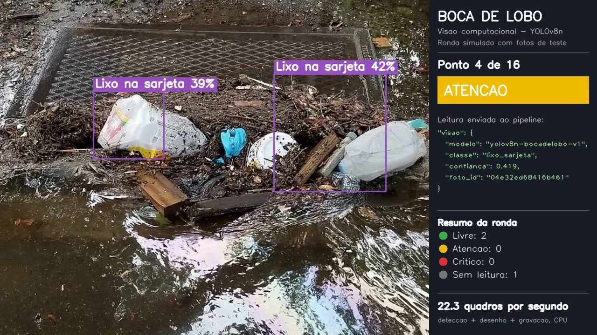

# Boca de Lobo · componente Visão (Applied Computer Vision)

> **GS 2026.2 · CitizenTech · Engenharia de Software 4º ano · FIAP**

Antes de cada temporal, um robô inspeciona as bocas de lobo do bairro e descobre quais estão entupidas.
Este repositório é o **olho do robô**: um detector YOLOv8 treinado de forma customizada que olha a imagem
da câmera, em tempo real, e diz se o ponto tem **bueiro livre**, **parcialmente obstruído**, **entupido**
ou **lixo acumulado na sarjeta**. Essa leitura segue para o pipeline de dados do produto, que cruza com a
previsão de chuva e as áreas de risco e avisa a equipe de limpeza e os moradores.

**Documento da entrega (PDF): [documento/Documento_Visao_BocaDeLobo.pdf](documento/Documento_Visao_BocaDeLobo.pdf)**

**Vídeo de demonstração: [resultados/demo/demo_ronda.mp4](resultados/demo/demo_ronda.mp4)**



## Integrantes

| Nome completo | RM |
|---|---|
| Açussena Macedo Mautone | 552568 |
| Felipe Heilmann Marques | 551026 |
| Felipe Voidela Toledo | 98595 |
| Carlos Eduardo Caramante Ribeiro | 552159 |
| Ian Cancian Nachtergaele | 98387 |

## Ficha técnica

| Item | Boca de Lobo |
|---|---|
| Nome do produto | Boca de Lobo |
| Cidadão e território | Morador de bairro que alaga todo verão, principalmente em áreas baixas e periféricas de São Paulo |
| Problema, em uma frase | Bueiro entupido + chuva forte = rua alagada, carro perdido e casa invadida, e ninguém avisa antes |
| Proposta de valor | Saber antes da chuva quais bueiros estão entupidos em área de risco: a equipe de limpeza recebe a rota priorizada, e o morador sabe onde não passar e o que fazer |
| O que a visão resolve | O sensor de ultrassom do robô mede a profundidade da sarjeta, mas não sabe se o que está ali é folha, lixo ou asfalto. A câmera com o YOLO enxerga a grelha e classifica o ponto em 4 estados, na hora, sem depender de alguém olhar foto por foto |
| Componentes do produto | Robô (Maker Lab) · **YOLO (Visão, este repo)** · assistente com RAG e agente (GenAI) · pipeline de dados (Big Data) · bot de alertas (RPA) · mapa público com observabilidade (DevOps) · modelo de negócio (BI) |
| Fontes de dados | 162 fotos reais de licença livre do Wikimedia Commons (autor e licença de cada uma em [dados/fontes.csv](dados/fontes.csv)), anotadas neste projeto; mais 128 imagens sintéticas usadas só no treino |
| Modelos de IA | `yolov8n-bocadelobo-v1`: YOLOv8n (3 milhões de parâmetros, 6 MB) treinado por transferência de aprendizado a partir do COCO. Grounding DINO só como apoio à anotação. Tudo roda local, em CPU |
| URL do MVP e repositório | Mapa do cidadão: https://felipevoidela.github.io/GS2-2026-Big-Data-Architecture/ · Este repositório: https://github.com/FelipeVoidela/GS2-2026-Applied-Computer-Vision |
| Indicadores de impacto | Acerto da leitura do ponto; bueiros com problema que passam sem alerta; quadros por segundo no hardware do robô |
| ODS | 11 (cidades resilientes), 13 (adaptação ao clima), 3 (saúde); a contribuição de cada um está logo abaixo |

**Como a visão contribui para os ODS**

* **ODS 11, meta 11.5** (menos pessoas afetadas por desastres, inclusive os relacionados à água): a leitura
  automática de cada boca de lobo é o dado que permite limpar antes da chuva os pontos críticos em área de risco.
* **ODS 13, meta 13.1** (resiliência e adaptação a riscos do clima): com chuvas fortes mais frequentes,
  inspecionar o bairro inteiro a cada ronda só é viável se a classificação for automática e em tempo real.
* **ODS 3, meta 3.3** (combate a doenças transmitidas pela água): menos água parada e menos enchente
  significam menos contato com água contaminada (leptospirose) e menos criadouros de mosquito.

## Resultado

Modelo `yolov8n-bocadelobo-v1`, avaliado nas **26 fotos reais de teste**, que ele não viu no treino
nem na escolha dos pesos ([resultados/teste/metricas.json](resultados/teste/metricas.json)):

| Classe | Caixas no teste | Precisão | Revocação | mAP@50 | mAP@50-95 |
|---|---|---|---|---|---|
| Bueiro livre | 19 | 0,558 | 0,947 | 0,850 | 0,449 |
| Parcialmente obstruído | 3 | 0,000 | 0,000 | 0,011 | 0,006 |
| Bueiro entupido | 1 | 0,000 | 0,000 | 0,000 | 0,000 |
| Lixo na sarjeta | 4 | 0,186 | 0,250 | 0,069 | 0,023 |
| **Média das 4 classes** | 27 | 0,186 | 0,299 | **0,232** | 0,119 |

| Leitura do ponto (uma foto, uma resposta) | |
|---|---|
| Acerto geral | 19 de 26 fotos (73,1%) |
| Bueiros livres lidos como livres | 18 de 19 |
| Pontos com problema que geraram alerta | **1 de 7** |
| Velocidade | 33,3 ms por quadro, **30,1 quadros por segundo** em CPU (AMD Ryzen 5 5600X 6-Core Processor), sem GPU |

O que esses números dizem, sem arredondar para cima:

* **Funciona: encontrar a boca de lobo, em tempo real.** Na classe livre o modelo acha quase todas as grelhas do teste
  (revocação de 94,7%, mAP@50 de 0,850), em fotos de vários países que nunca viu, a 30 quadros por
  segundo em um processador comum.
* **Ainda não funciona: graduar a obstrução.** Dos 7 pontos de teste com problema (obstruídos ou com lixo na sarjeta),
  só 1 gerou alerta. O modelo acerta 125 das 128 montagens sintéticas e 11 das 12 fotos reais obstruídas do próprio
  treino, mas nenhuma das fotos obstruídas do teste: decorou os poucos exemplos, sem aprender a obstrução como ela
  aparece em fotos novas. A média das 4 classes (0,232) reflete isso.
* **O teste é pequeno.** São 4 fotos reais com bueiro obstruído no teste. Os números dessas classes dizem "ainda não
  funciona", mas não medem com precisão o quanto falta.

Na versão atual, a visão serve para **localizar e contar as bocas de lobo** de uma ronda e confirmar as que estão
limpas; o estado do ponto (livre, atenção, crítico) deve continuar vindo do sensor de ultrassom do robô até o modelo
ser retreinado com fotos reais de bueiros obstruídos. A análise completa, as curvas de treino e os exemplos de acertos
e erros estão no [documento da entrega](documento/Documento_Visao_BocaDeLobo.pdf) e em [resultados/](resultados/).


O vídeo de demonstração é uma **ronda simulada**: cada foto de teste vira alguns segundos de vídeo com movimento de
câmera, e o modelo roda em todos os quadros durante a gravação (18,7 quadros por segundo com detecção, painel e
codificação do vídeo juntos). Ele mostra os acertos e os erros descritos acima. Ainda não há filmagem do robô em campo;
para gravar com câmera de verdade, use `python detectar.py --fonte 0 --salvar demo.mp4`.

## Como funciona


1. **Fotos** de bocas de lobo, grelhas e sarjetas, de licença livre, baixadas do Wikimedia Commons.
2. **Pré-anotação** com Grounding DINO (detector que localiza o que uma frase descreve) e **revisão visual**
   de cada caixa proposta: uma das 4 classes ou descartar.
3. **Dataset YOLO** dividido em treino, validação e teste, sem fotos da mesma série em conjuntos diferentes.
4. **Treino customizado** do YOLOv8n, partindo dos pesos do COCO.
5. **Detecção em tempo real** na câmera do robô (`detectar.py`), com o estado do ponto na tela.
6. **Leitura enviada** ao pipeline de dados no formato do contrato (classe, confiança e `foto_id`).

### As 4 classes e o critério de anotação


| Classe (`visao.classe`) | Critério | Estado sugerido para o ponto |
|---|---|---|
| `livre` | Abertura desobstruída; no máximo sujeira leve (até cerca de 1/4 coberta) | livre |
| `parcialmente_obstruido` | Folhas, lixo ou terra cobrindo parte da abertura (entre 1/4 e 3/4) | atenção |
| `entupido` | Abertura quase toda coberta (mais de 3/4) ou tomada por lama | crítico |
| `lixo_sarjeta` | Lixo ou folhas acumulados na sarjeta, fora do bueiro | atenção |

Os nomes são exatamente os que a camada Prata do [pipeline de dados](https://github.com/FelipeVoidela/GS2-2026-Big-Data-Architecture)
aceita no campo `visao.classe`.

## Os dados

| | |
|---|---|
| Origem | Wikimedia Commons, pela API pública. Categorias de bocas de lobo, sarjetas e grelhas, mais buscas por texto |
| Licenças | Só fotos de licença livre (CC BY, CC BY-SA, CC0, domínio público). Autor, licença e página de cada foto em [dados/fontes.csv](dados/fontes.csv) |
| Anotação | 574 caixas propostas pelo Grounding DINO, revisadas uma a uma; 198 aceitas. Decisões em [dados/anotacao/revisao.csv](dados/anotacao/revisao.csv) |
| Conjunto final | 162 fotos reais e 199 caixas: 110 de treino, 26 de validação e 26 de teste |
| Sintéticas | 128 imagens geradas por copiar e colar (lixo real sobre bueiro real), **só no treino**. Validação e teste são 100% fotos reais |

**Por que imagens sintéticas (justificativa):** nas fotos públicas, bueiro livre é comum e bueiro entupido é
raro, porque quase ninguém fotografa o problema. Com meia dúzia de exemplos reais das classes de obstrução, o
modelo aprenderia só a classe fácil. O script [scripts/04b_gerar_sinteticos.py](scripts/04b_gerar_sinteticos.py)
cola recortes reais de folhas e lixo (das caixas `lixo_sarjeta` do treino) sobre bueiros reais anotados como
livres, cobrindo de 30% a 65% da grelha (parcialmente obstruído) ou mais de 82% (entupido). É determinístico:
as imagens não ficam no Git e são regeneradas, sempre iguais, pelo script.


**Não são fotos tiradas pela equipe.** O plano do produto é treinar com fotos das bocas de lobo da região
piloto (zona leste de São Paulo). O pipeline está pronto para isso: basta colocar as fotos em `dados/brutas/`
e rodar os passos 2 a 6 de novo. Ver [Limitações](#limitações-e-próximos-passos).

## Como rodar

Precisa de Python 3.10 ou mais novo. Não precisa de GPU.

```bash
git clone https://github.com/FelipeVoidela/GS2-2026-Applied-Computer-Vision.git
cd GS2-2026-Applied-Computer-Vision
python -m venv .venv
.venv\Scripts\activate            # no Linux ou macOS: source .venv/bin/activate
pip install -r requirements.txt
```

### Detecção em tempo real (o modelo treinado já está em `modelos/`)

```bash
python detectar.py --fonte 0                          # webcam: janela ao vivo, q para sair
python detectar.py --fonte video.mp4 --salvar saida.mp4
python detectar.py --fonte dados/dataset/images/test --salvar saida --json leituras.jsonl --sem-janela
```

Na tela: caixas coloridas por classe, FPS e, embaixo, o estado do ponto (LIVRE, ATENCAO ou CRITICO).
O estado é o mais votado nos últimos quadros, para o alerta não piscar quando uma detecção falha por um instante.

### Reproduzir tudo, do zero

```bash
python scripts/01_coletar_imagens.py     # baixa as fotos do Commons (lento: o Commons limita o volume)
pip install transformers                 # só para a pré-anotação
python scripts/02_pre_anotar.py          # propõe as caixas (Grounding DINO)
python scripts/03_folhas_revisao.py      # folhas de contato para a revisão -> dados/anotacao/revisao.csv
python scripts/03b_folhas_manuais.py     # fotos sem caixa aceita -> dados/anotacao/manuais.csv
python scripts/04_montar_dataset.py      # dataset YOLO (treino, validação, teste)
python scripts/04b_gerar_sinteticos.py   # imagens sintéticas, só no treino
python scripts/05_treinar.py             # treino do YOLOv8n (cerca de 40 min em CPU)
python scripts/06_avaliar.py             # métricas no teste -> resultados/teste/metricas.json
python scripts/07_gerar_video_demo.py    # vídeo de demonstração
python scripts/08_figuras.py             # figuras do README e do documento
python scripts/09_gerar_documento.py     # PDF da entrega
```

Para só **retreinar com o dataset do repositório**, comece em `04b_gerar_sinteticos.py`: as fotos reais e os
rótulos já estão em `dados/dataset/`.

Testes da regra que transforma detecções na leitura enviada ao pipeline: `pip install pytest` e `pytest -q`.

## Integração com o produto

O robô envia, em cada inspeção, um bloco `visao` que o [pipeline de dados](https://github.com/FelipeVoidela/GS2-2026-Big-Data-Architecture)
lê na Bronze e valida na Prata (classe conhecida e confiança entre 0 e 1). Este repositório gera esse bloco:

```json
{"modelo": "yolov8n-bocadelobo-v1", "classe": "entupido", "confianca": 0.871, "foto_id": "886935bd3b0c8ab3"}
```

* **Regra do ponto** ([contrato.py](src/boca_de_lobo_visao/contrato.py)): se há boca de lobo no quadro, vale a de
  maior confiança; se só há lixo na sarjeta, vale o lixo; sem detecção, não há leitura de visão.
* **LGPD:** a foto não sai do robô. Vai a classe, a confiança e o `foto_id`, que é um hash da imagem, suficiente
  para auditar a leitura sem transmitir rostos ou placas que estejam na cena.
* **Pessoa no circuito:** a visão só sugere o estado do ponto. A prioridade de limpeza é calculada no pipeline
  de dados, que combina essa leitura com o ultrassom, a chuva prevista e a área de risco, e quem decide mandar a
  equipe é uma pessoa.
* Hoje o pipeline de dados usa um simulador do robô com esse mesmo formato. Quando o robô estiver em campo, é só
  apontar a tarefa de coleta para a saída de `detectar.py --json`.

## Estrutura do repositório

```
detectar.py                  detecção em tempo real (webcam, vídeo, fotos)
src/boca_de_lobo_visao/      classes, detector (modelo + desenho) e contrato com o pipeline de dados
scripts/                     passos 01 a 09, na ordem em que rodam
modelos/                     yolov8n-bocadelobo-v1.pt (pesos treinados)
dados/fontes.csv             autor, licença e página de cada foto
dados/anotacao/              caixas propostas, decisões da revisão e caixas manuais
dados/dataset/               dataset YOLO (fotos reais, rótulos, data.yaml, resumo.json)
resultados/treino/           curvas e configuração do treino
resultados/teste/            métricas, matriz de confusão e exemplos de acertos e erros
resultados/demo/             vídeo de demonstração e as leituras de cada ponto
documento/                   PDF da entrega e o texto que o gera
docs/                        figuras
tests/                       testes do contrato
```

## Limitações e próximos passos

* **As classes de obstrução não são confiáveis.** É a limitação principal, medida acima. A causa é falta de dado real:
  o treino tem 12 caixas reais de bueiro obstruído contra 92 de bueiro livre, e as imagens sintéticas não supriram a falta.
* **Não são fotos da equipe nem de São Paulo.** As fotos são de vários países, e a maioria mostra grelhas. Em São Paulo
  predomina a boca de lobo de guia (abertura na lateral da calçada), quase ausente nas fotos públicas.
* **Lixo na sarjeta veio quase todo de uma série só.** 33 das 38 caixas reais do treino são do mesmo fotógrafo, na mesma rua;
  o modelo não generalizou para outros cenários.
* **Conjunto de teste pequeno** (26 fotos): as métricas das classes raras são indicativas.
* **Coleta lenta.** O Wikimedia Commons limita o download de clientes sem identificação; no prazo foram baixadas
  432 das 739 fotos de interesse levantadas. Rodar `scripts/01_coletar_imagens.py` de novo continua de onde parou.
* **A revisão das caixas não teve dupla checagem.** Cada caixa foi revisada uma vez; casos de fronteira entre livre e
  parcialmente obstruído podem ter ficado inconsistentes.

Próximos passos, em ordem:

1. Fotografar bocas de lobo da região piloto (zona leste de São Paulo), livres e obstruídas, com a câmera e o ângulo
   do robô; meta de pelo menos 50 exemplos reais por classe no teste.
2. Colocar as fotos em `dados/brutas/` e rodar os passos 2 a 6: o pipeline aceita as fotos novas sem mudança de código.
3. Medir de novo e só então ligar a leitura da visão no cálculo de prioridade do pipeline de dados.
4. Exportar o modelo para o computador embarcado do robô (ONNX ou NCNN) e medir o FPS nele.

## Licenças

O código deste repositório é da equipe. As fotos em `dados/dataset/` são de terceiros, publicadas no
Wikimedia Commons sob licença livre (CC BY, CC BY-SA, CC0 ou domínio público); o autor e a licença de cada
uma estão em [dados/fontes.csv](dados/fontes.csv). Os pesos de partida do YOLOv8n e a biblioteca Ultralytics
são distribuídos sob AGPL-3.0.
