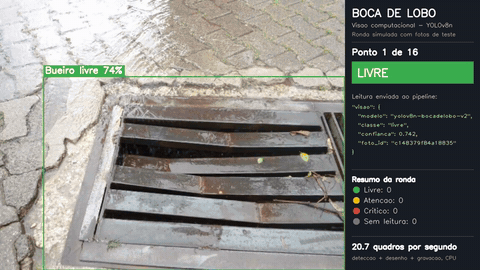
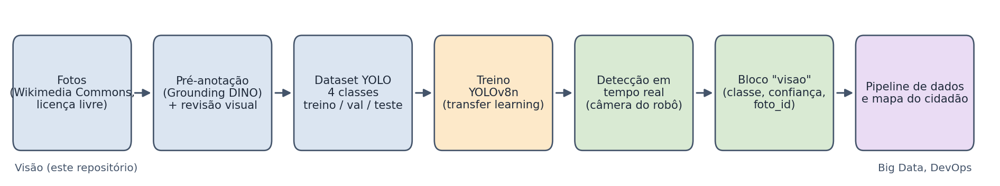
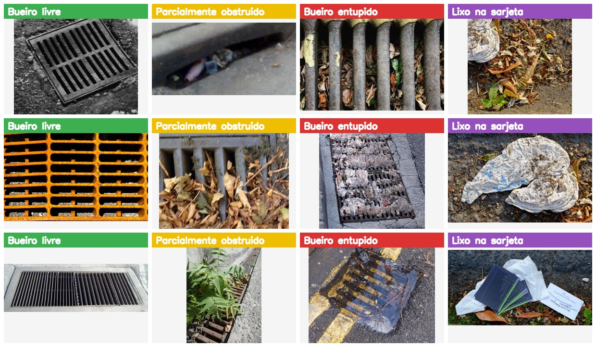
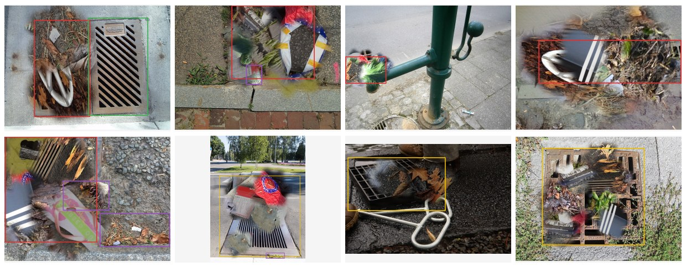

# Boca de Lobo · componente Visão (Applied Computer Vision)

> **GS 2026.2 · CitizenTech · Engenharia de Software 4º ano · FIAP**

Antes de cada temporal, um robô inspeciona as bocas de lobo do bairro e descobre quais estão entupidas.
Este repositório é o **olho do robô**: um sistema de duas etapas, as duas com treinamento customizado, que
olha a imagem da câmera, em tempo real, e diz se o ponto tem **bueiro livre**, **parcialmente obstruído**,
**entupido** ou **lixo acumulado na sarjeta**. Um detector **YOLOv8n** localiza as bocas de lobo, e um
**graduador** (camadas lineares sobre os codificadores CLIP e DINOv2) decide se cada uma está obstruída.
Essa leitura segue para o pipeline de dados do produto, que cruza com a previsão de chuva e as áreas de
risco e avisa a equipe de limpeza e os moradores.

**Documento da entrega (PDF): [documento/Documento_Visao_BocaDeLobo.pdf](documento/Documento_Visao_BocaDeLobo.pdf)**

**Vídeo de Applied Computer Vision (YouTube): [youtu.be/fr6dg2dogik](https://youtu.be/fr6dg2dogik)**. Apresenta este
componente e mostra a solução funcionando.

**Vídeo do projeto completo (YouTube): [youtube.com/watch?v=c0afZJsIye8](https://www.youtube.com/watch?v=c0afZJsIye8)**.
É o pitch do Boca de Lobo, da disciplina Business Intelligence & Startup Development: explica o produto como um todo.

**Ronda simulada (53 s, arquivo no repositório): [resultados/demo/demo_ronda.mp4](https://github.com/FelipeVoidela/GS2-2026-Applied-Computer-Vision/raw/main/resultados/demo/demo_ronda.mp4)**.
O GitHub não toca vídeo guardado no repositório: o link baixa o arquivo (17 MB). A prévia abaixo mostra os 4 primeiros
pontos da ronda, um de cada classe anotada: o sistema acerta o bueiro livre, acusa a obstrução no parcialmente obstruído
(errando o grau: lê como entupido), acusa material acumulado no bueiro entupido (sem reconhecer que há um bueiro
debaixo) e não vê o lixo na sarjeta.



## Integrantes

| Nome completo | RM |
|---|---|
| Açussena Macedo Mautone | 552568 |
| Felipe Heilmann Marques | 551026 |
| Felipe Voidela Toledo | 98595 |
| Carlos Eduardo Caramante Ribeiro | 552159 |
| Ian Cancian Nachtergaele | 98387 |

## Ficha técnica

| Item | Boca de Lobo |
|---|---|
| Nome do produto | Boca de Lobo |
| Cidadão e território | Morador de bairro que alaga todo verão, principalmente em áreas baixas e periféricas de São Paulo |
| Problema, em uma frase | Bueiro entupido + chuva forte = rua alagada, carro perdido e casa invadida, e ninguém avisa antes |
| Proposta de valor | Saber antes da chuva quais bueiros estão entupidos em área de risco: a equipe de limpeza recebe a rota priorizada, e o morador sabe onde não passar e o que fazer |
| O que a visão resolve | O sensor de ultrassom do robô mede a profundidade da sarjeta, mas não sabe se o que está ali é folha, lixo ou asfalto. A câmera enxerga a grelha e classifica o ponto em 4 estados, na hora, sem depender de alguém olhar foto por foto |
| Componentes do produto | Robô (Maker Lab) · **YOLO + graduador (Visão, este repo)** · assistente com RAG e agente (GenAI) · pipeline de dados (Big Data) · bot de alertas (RPA) · mapa público com observabilidade (DevOps) · modelo de negócio (BI) |
| Fontes de dados | 296 fotos reais de licença livre, do Wikimedia Commons e do Flickr (autor e licença de cada uma em [dados/fontes.csv](dados/fontes.csv)), anotadas neste projeto; mais imagens sintéticas usadas só no treino |
| Modelos de IA | Primeira etapa, `yolov8n-bocadelobo-v2`: YOLOv8n (3 milhões de parâmetros, 6 MB) treinado por transferência de aprendizado a partir do COCO. Segunda etapa, `graduador-obstrucao-v1`: camadas lineares treinadas neste projeto sobre os codificadores CLIP ViT-B/32 e DINOv2 ViT-S/14, congelados. Grounding DINO só como apoio à anotação. Tudo roda local, em CPU |
| URL do MVP e repositório | Mapa do cidadão: https://felipevoidela.github.io/GS2-2026-Big-Data-Architecture/ · Este repositório: https://github.com/FelipeVoidela/GS2-2026-Applied-Computer-Vision |
| Indicadores de impacto | Acerto da leitura do ponto; bueiros com problema que passam sem alerta; quadros por segundo no hardware do robô |
| ODS | 11 (cidades resilientes), 13 (adaptação ao clima), 3 (saúde); a contribuição de cada um está logo abaixo |

**Como a visão contribui para os ODS**

* **ODS 11, meta 11.5** (menos pessoas afetadas por desastres, inclusive os relacionados à água): a leitura
  automática de cada boca de lobo é o dado que permite limpar antes da chuva os pontos críticos em área de risco.
* **ODS 13, meta 13.1** (resiliência e adaptação a riscos do clima): com chuvas fortes mais frequentes,
  inspecionar o bairro inteiro a cada ronda só é viável se a classificação for automática e em tempo real.
* **ODS 3, meta 3.3** (combate a doenças transmitidas pela água): menos água parada e menos enchente
  significam menos contato com água contaminada (leptospirose) e menos criadouros de mosquito.

## Resultado

Sistema entregue: YOLO `yolov8n-bocadelobo-v2` + `graduador-obstrucao-v1`, avaliado nas **48 fotos reais de teste**,
que nenhuma das duas etapas viu no treino nem nas decisões ([resultados/teste/metricas.json](resultados/teste/metricas.json)).
O teste foi medido uma vez, depois de tudo decidido pela validação.

| Leitura do ponto no teste (uma foto, uma resposta) | Só o YOLO (até a 3ª rodada) | **YOLO + graduador (entregue)** |
|---|---|---|
| Pontos com problema que geraram alerta | 4 de 15 | **12 de 15** |
| Bueiros obstruídos que geraram alerta | 0 de 9 | **6 de 9** |
| Bueiros obstruídos lidos como obstruídos | 0 de 9 | 2 de 9 |
| Bueiros livres lidos como problema (alarme falso) | 3 de 33 | 2 de 33 |
| Bueiros livres lidos como livres | 23 de 33 | 25 de 33 |
| Leituras certas (classe exata) | 26 de 48 (54,2%) | **31 de 48 (64,6%)** |

| Velocidade em CPU (AMD Ryzen 5 5600X 6-Core Processor, sem GPU) | |
|---|---|
| YOLO, em todos os quadros | 29,2 ms por quadro, **34,2 quadros por segundo** |
| YOLO + graduador em todos os quadros | 124,7 ms por quadro, 8,0 quadros por segundo |
| YOLO em todos os quadros e graduador a cada 5, como `detectar.py` faz em vídeo | 20,7 quadros por segundo (calculado a partir dos dois tempos) |

O que esses números dizem, sem arredondar para cima:

* **Funciona: avisar que o ponto tem problema.** É o erro que mais pesa para o cidadão, porque o bueiro com problema
  que passa sem alerta é o que alaga a rua. Só com o YOLO, 11 dos 15 pontos com problema do teste passavam sem
  alerta; com a segunda etapa passam 3. Dos 9 bueiros obstruídos, nenhum gerava alerta; agora 6 geram. E os alarmes
  falsos não subiram: 2 dos 33 bueiros livres (eram 3).
* **Funciona: encontrar a boca de lobo, em tempo real.** Na classe livre o mAP@50 do YOLO é 0,787 e a precisão é de
  88,2%. Ele roda a 34 quadros por segundo em um processador comum.
* **Ainda não funciona: graduar a obstrução.** Dos 6 bueiros obstruídos que geram alerta, só 2 são lidos como
  obstruídos. Os outros 4 recebem a leitura `lixo_sarjeta`, que na cabeça de quadro quer dizer "material acumulado e
  nenhuma grelha à vista": o status é o mesmo (atenção) e o ponto entra na rota de limpeza, mas o sistema não distingue
  o bueiro coberto do lixo solto, nem o parcialmente obstruído do entupido.
* **O gargalo que resta é a localização.** O YOLO não encontra 6 dos 33 bueiros livres do teste, e a segunda etapa só
  gradua o que a primeira localiza.

Leituras do sistema no teste (linhas: classe anotada; colunas: classe que o robô enviaria):

| Anotado \ Previsto | Bueiro livre | Parcialmente obstruído | Bueiro entupido | Lixo na sarjeta | Nada detectado |
|---|---|---|---|---|---|
| Bueiro livre (33) | 25 | 1 | 0 | 1 | 6 |
| Parcialmente obstruído (7) | 1 | 1 | 0 | 3 | 2 |
| Bueiro entupido (2) | 0 | 1 | 0 | 1 | 0 |
| Lixo na sarjeta (6) | 0 | 1 | 0 | 5 | 0 |

Detecção da primeira etapa (o YOLO sozinho), por classe, no teste:

| Classe | Caixas no teste | Precisão | Revocação | mAP@50 | mAP@50-95 |
|---|---|---|---|---|---|
| Bueiro livre | 33 | 0,882 | 0,680 | 0,787 | 0,499 |
| Parcialmente obstruído | 7 | 0,000 | 0,000 | 0,038 | 0,016 |
| Bueiro entupido | 2 | 0,000 | 0,000 | 0,000 | 0,000 |
| Lixo na sarjeta | 9 | 0,396 | 0,222 | 0,155 | 0,029 |
| **Média das 4 classes** | 51 | 0,320 | 0,226 | **0,245** | 0,136 |

A tabela acima explica por que a segunda etapa existe. O YOLO acerta 124 das 128 montagens sintéticas e 12 das 12
fotos reais obstruídas do próprio treino ([conferência](resultados/historico/rodada2_conferencia_treino.json)) e
nenhuma das 9 do teste: decorou os poucos exemplos, sem aprender a obstrução como ela aparece em fotos novas. A
análise completa, as curvas de treino e os exemplos de acertos e erros estão no
[documento da entrega](documento/Documento_Visao_BocaDeLobo.pdf) e em [resultados/](resultados/).

### Quatro rodadas

O YOLO entregue é o da **segunda rodada**; a segunda etapa veio na **quarta**. O que mudou em cada uma:

1. **Primeira:** as imagens sintéticas eram só montagens de lixo sobre a grelha, e o YOLO aprendeu a reconhecer a
   colagem em vez da obstrução.
2. **Segunda (YOLO entregue):** lixo colado também **ao lado** de bueiros que continuam livres (para a marca da colagem
   deixar de denunciar a classe), colagem com borda mais nítida e repetição das fotos reais de bueiro obstruído.
3. **Terceira:** mais dado real. Buscas dirigidas a bueiro obstruído levaram o conjunto de 162 para 296 fotos reais,
   e as fotos reais de bueiro obstruído no treino, de 12 para 21. Não cumpriu o critério e não foi adotada.
4. **Quarta (segunda etapa entregue):** sem mais fotos para buscar (as buscas refeitas trouxeram 89 fotos, 2 delas
   com bueiro obstruído), mudou a arquitetura. O YOLO da segunda rodada passou a só localizar, e um graduador
   treinado sobre o CLIP e o DINOv2 passou a classificar.

Em cada troca, o critério foi fixado antes e usa só a **validação**.

As três primeiras rodadas nas **mesmas 26 fotos de validação e 26 de teste** das duas primeiras
([métricas](resultados/historico/)):

| Rodada | mAP@50 (validação) | Leituras certas (validação) | Problemas alertados (validação) | mAP@50 (teste) | Leituras certas (teste) | Problemas alertados (teste) |
|---|---|---|---|---|---|---|
| 1ª: só montagens sobre a grelha | 0,296 | 19 de 26 | 0 de 6 | 0,232 | 19 de 26 | 1 de 7 |
| 2ª: montagens também ao lado da grelha | 0,352 | 21 de 26 | 1 de 6 | 0,242 | 19 de 26 | 3 de 7 |
| 3ª: mais fotos reais | 0,447 | 18 de 26 | 0 de 6 | 0,259 | 19 de 26 | 2 de 7 |

As rodadas na **validação e no teste ampliados** (48 e 48 fotos). O mAP é sempre o do YOLO, por isso é igual na
segunda e na quarta, que usam o mesmo YOLO:

| Rodada | mAP@50 (validação) | Leituras certas (validação) | Problemas alertados (validação) | mAP@50 (teste) | Leituras certas (teste) | Problemas alertados (teste) |
|---|---|---|---|---|---|---|
| 2ª: só o YOLO | 0,353 | 35 de 48 | 4 de 13 | 0,245 | 26 de 48 | 4 de 15 |
| 3ª: mais fotos reais, só o YOLO | 0,348 | 32 de 48 | 2 de 13 | 0,227 | 30 de 48 | 6 de 15 |
| **4ª: YOLO da 2ª + graduador (entregue)** | 0,353 | 39 de 48 | 11 de 13 | 0,245 | 31 de 48 | 12 de 15 |

**A terceira rodada não cumpriu o critério dela** (reconhecer pelo menos dois bueiros obstruídos a mais que a segunda,
ler como problema no máximo 10% dos bueiros livres e não perder mais de cinco pontos percentuais de acerto nos
livres): na validação ampliada reconheceu 0 dos 5 bueiros obstruídos (a segunda, 1). Repetiu o padrão da segunda:
acerta 20 das 21 fotos reais obstruídas do próprio treino e nenhuma das novas. Os pesos estão em
`modelos/yolov8n-bocadelobo-v3.pt` para conferência.

**O experimento que fechou a terceira rodada apontou o caminho da quarta**
([scripts/10_experimento_clip.py](scripts/10_experimento_clip.py)): mesmo sem treino, o CLIP separava bem bueiro
obstruído de livre nos recortes anotados (AUC de 0,90 no treino e 0,94 na validação), mas de ponta a ponta a leitura
não mudava (1 de 5), porque o limiar era rígido e parte dos bueiros obstruídos nem era detectada
([resultado](resultados/experimentos/clip_segunda_etapa.json)). A quarta rodada respondeu aos dois pontos: camadas
treinadas sobre dois codificadores, com limiar tirado da validação cruzada, e a cabeça de quadro para quando não há
caixa.

**Na quarta rodada o critério mudou de alvo, e isso fica dito.** Na validação, o sistema tinha de alertar pelo menos
dois pontos com problema a mais que o YOLO sozinho, ler como problema no máximo 10% dos bueiros livres e não perder
mais de cinco pontos percentuais de acerto nos livres. Cumpriu: alertou 11 dos 13 pontos com problema (o YOLO sozinho,
4), leu como problema 2 dos 35 bueiros livres e acertou 32 deles (antes, 33)
([medida](resultados/graduador/validacao.json)). Pelo critério antigo, de bueiros lidos **como obstruídos**, não
cumpriria: foram 2 de 5, um a mais que antes. Só depois dessa decisão o teste foi medido.

O treino do graduador ([relatório](resultados/graduador/treino.json)), com as pontuações do treino medidas fora da
dobra (validação cruzada em 5 dobras, separadas por autor da foto):

| Cabeça | Exemplos de treino (com e sem problema) | AUC no treino | Com problema acima do limiar (treino) | Sem problema acima do limiar (treino) | AUC na validação | Com problema acima do limiar (validação) | Sem problema acima do limiar (validação) |
|---|---|---|---|---|---|---|---|
| Recorte: bueiro obstruído ou livre | 21 e 154 | 0,952 | 19 de 21 | 16 de 154 | 0,926 | 4 de 6 | 1 de 36 |
| Quadro: ponto com problema ou livre | 53 e 147 | 0,920 | 41 de 53 | 15 de 147 | 0,954 | 8 de 13 | 0 de 35 |

Depois de tudo escolhido só com o treino e medido na validação, as camadas finais foram reajustadas com treino e
validação juntos (com 21 exemplos da classe rara, os 6 da validação fazem diferença); a validação da tabela de
rodadas é sempre a das camadas treinadas só com o treino.

**Dois caminhos testados na quarta rodada não entraram**
([medidas](resultados/experimentos/quarta_rodada.json), scripts em [scripts/experimentos_rodada4/](scripts/experimentos_rodada4/)):
um YOLO com as três classes de boca de lobo unificadas em uma só, para a obstrução deixar de competir com a
localização, localizou na validação os mesmos 4 dos 6 bueiros obstruídos; e uma terceira cabeça, para distinguir nas
caixas de lixo o bueiro coberto do lixo solto, separava bem os recortes anotados (AUC de 0,99 no treino) mas não
mudou nenhuma leitura de ponta a ponta.


O vídeo de demonstração é uma **ronda simulada**: cada foto de teste vira alguns segundos de vídeo com movimento de
câmera, e o sistema roda durante a gravação como rodaria na câmera, com o YOLO em todos os quadros e o graduador a
cada 5 (12,4 quadros por segundo com detecção, graduação, painel e codificação do vídeo juntos). Dos 16 pontos, 5
foram lidos como livres, 7 em atenção, 3 críticos e 1 ficou sem leitura. Dos 11 pontos com problema anotado, 9
geraram alerta; dos 5 livres, 4 foram lidos como livres. Com a câmera em movimento as leituras oscilam mais que na
foto parada, e o grau da obstrução aparece trocado em vários pontos. Ainda não há filmagem do robô em campo; para
gravar com câmera de verdade, use `python detectar.py --fonte 0 --salvar demo.mp4`.

## Como funciona



1. **Fotos** de bocas de lobo, grelhas e sarjetas, de licença livre, baixadas do Wikimedia Commons e do Flickr.
2. **Pré-anotação** com Grounding DINO (detector que localiza o que uma frase descreve) e **revisão visual**
   de cada caixa proposta: uma das 4 classes ou descartar.
3. **Dataset YOLO** dividido em treino, validação e teste, sem fotos da mesma série em conjuntos diferentes.
4. **Treino customizado** em duas partes: o YOLOv8n, partindo dos pesos do COCO, aprende a localizar; o
   graduador, camadas lineares sobre o CLIP e o DINOv2 congelados, aprende a dizer o estado.
5. **Detecção em tempo real** na câmera do robô (`detectar.py`), com o estado do ponto na tela.
6. **Leitura enviada** ao pipeline de dados no formato do contrato (classe, confiança e `foto_id`).

### As duas etapas

| Etapa | O que faz | Como foi treinada |
|---|---|---|
| 1. YOLOv8n | Em todos os quadros, localiza as bocas de lobo e o lixo na sarjeta | Rede inteira ajustada ao dataset, a partir dos pesos do COCO ([scripts/05_treinar.py](scripts/05_treinar.py)) |
| 2. Graduador, cabeça de **recorte** | Olha o recorte de cada caixa de boca de lobo e decide: livre ou obstruída | Uma camada linear sobre o CLIP e outra sobre o DINOv2, treinadas com as caixas reais do treino ([scripts/11_treinar_graduador.py](scripts/11_treinar_graduador.py)) |
| 2. Graduador, cabeça de **quadro** | Só quando o YOLO não detecta nada: olha o quadro inteiro e decide se há material acumulado no ponto | Idem, treinada com as fotos reais inteiras (ponto livre contra ponto com problema) |

Por que duas etapas: com cerca de vinte fotos reais de bueiro obstruído, o YOLO localiza a grelha mas a lê
como livre. O CLIP e o DINOv2 já foram treinados com centenas de milhões de imagens e "conhecem" folhas,
lixo e a textura de uma grelha; ajustar só uma camada linear em cima deles generaliza melhor do que ajustar
os 3 milhões de pesos do YOLO. E a cabeça de quadro cobre o caso em que o lixo esconde a grelha inteira e
não sobra o que detectar: o ponto recebe a leitura `lixo_sarjeta` (atenção), que significa "há material
acumulado e nenhuma grelha à vista".

### As 4 classes e o critério de anotação



| Classe (`visao.classe`) | Critério | Estado sugerido para o ponto |
|---|---|---|
| `livre` | Abertura desobstruída; no máximo sujeira leve (até cerca de 1/4 coberta) | livre |
| `parcialmente_obstruido` | Folhas, lixo ou terra cobrindo parte da abertura (entre 1/4 e 3/4) | atenção |
| `entupido` | Abertura quase toda coberta (mais de 3/4) ou tomada por lama | crítico |
| `lixo_sarjeta` | Lixo ou folhas acumulados na sarjeta, fora do bueiro | atenção |

Os nomes são exatamente os que a camada Prata do [pipeline de dados](https://github.com/FelipeVoidela/GS2-2026-Big-Data-Architecture)
aceita no campo `visao.classe`.

## Os dados

| | |
|---|---|
| Origem | **Wikimedia Commons** (categorias de bocas de lobo, sarjetas e grelhas, mais buscas por texto) e, na terceira rodada, **Flickr pelo Openverse**, com buscas dirigidas a bueiro obstruído ("blocked drain", "storm drain leaves", "bueiro entupido"...). 1.463 fotos baixadas: 614 do Commons e 849 do Flickr. As 89 últimas vieram das buscas refeitas na quarta rodada, com outras palavras e em outros idiomas: só 2 mostram um bueiro obstruído, e o conjunto não mudou |
| Licenças | Só fotos de licença livre que permite redistribuir e modificar (CC BY, CC BY-SA, CC0, domínio público). Autor, licença e página de cada foto em [dados/fontes.csv](dados/fontes.csv) |
| Anotação | As buscas por texto trazem muito ruído (tampas, rios, pessoas), então as fotos do Flickr passaram por uma triagem antes. 1.066 caixas propostas pelo Grounding DINO e revisadas: 320 aceitas, mais 36 desenhadas à mão onde o detector não propôs nada. Decisões em [dados/anotacao/revisao.csv](dados/anotacao/revisao.csv) e [manuais.csv](dados/anotacao/manuais.csv) |
| Fotos repetidas | 25 fotos apareciam nas duas fontes (a mesma foto no Flickr e no Commons, uma delas do teste). [scripts/01c_achar_repetidas.py](scripts/01c_achar_repetidas.py) acha as cópias por assinatura da imagem e elas entram uma vez só |
| Conjunto final | 296 fotos reais e 350 caixas: 200 de treino, 48 de validação e 48 de teste. As 162 fotos das duas primeiras rodadas continuam no mesmo conjunto em que estavam ([divisao.csv](dados/anotacao/divisao.csv)) |
| Bueiros obstruídos reais | 36 fotos: 21 no treino, 6 na validação e 9 no teste (eram 12, 4 e 4) |
| Sintéticas | 184 imagens geradas por copiar e colar (lixo real colado em foto real de bueiro) e 63 repetições das fotos reais de bueiro obstruído, **só no treino**. Validação e teste são 100% fotos reais, sem repetição |

**Por que imagens sintéticas (justificativa):** nas fotos públicas, bueiro livre é comum e bueiro entupido é
raro, porque quase ninguém fotografa o problema. Com meia dúzia de exemplos reais das classes de obstrução, o
modelo aprenderia só a classe fácil. O script [scripts/04b_gerar_sinteticos.py](scripts/04b_gerar_sinteticos.py)
cola recortes reais de folhas e lixo (das caixas `lixo_sarjeta` do treino) em fotos reais de bueiros livres, de três
jeitos:

| Tipo | Como é feita | Imagens |
|---|---|---|
| Parcialmente obstruído | lixo sobre a grelha, cobrindo de 30% a 65% | 53 |
| Entupido | lixo sobre a grelha, cobrindo 82% ou mais | 66 |
| Livre com lixo ao lado | lixo fora da grelha: ela continua `livre` e o recorte ganha uma caixa `lixo_sarjeta` | 65 |

É determinístico: as imagens não ficam no Git e são regeneradas, sempre iguais, pelo script. Elas ajudaram menos do
que o esperado; ver [Resultado](#resultado).



**Não são fotos tiradas pela equipe.** O plano do produto é treinar com fotos das bocas de lobo da região
piloto (zona leste de São Paulo). O pipeline está pronto para isso: basta colocar as fotos em `dados/brutas/`
e rodar os passos 2 a 6 de novo. Ver [Limitações](#limitações-e-próximos-passos).

## Como rodar

Precisa de Python 3.10 ou mais novo (testado com 3.11). Não precisa de GPU. As versões das bibliotecas estão
fixadas em `requirements.txt`: são as que produziram os números deste README.

```bash
git clone https://github.com/FelipeVoidela/GS2-2026-Applied-Computer-Vision.git
cd GS2-2026-Applied-Computer-Vision
python -m venv .venv
.venv\Scripts\activate            # no Linux ou macOS: source .venv/bin/activate
pip install -r requirements.txt
```

### Detecção em tempo real (os modelos treinados já estão em `modelos/`)

```bash
python detectar.py --fonte 0                          # webcam: janela ao vivo, q para sair
python detectar.py --fonte video.mp4 --salvar saida.mp4
python detectar.py --fonte dados/dataset/images/test --salvar saida --json leituras.jsonl --sem-janela
python detectar.py --fonte 0 --sem-graduador          # só a primeira etapa (YOLO)
```

Para ver a detecção ao vivo sem câmera: `python scripts/07_gerar_video_demo.py --so-bruto` grava a ronda simulada sem
nada desenhado (`resultados/demo/ronda_bruta.mp4`), e `python detectar.py --fonte resultados/demo/ronda_bruta.mp4`
roda o sistema sobre ela, na janela.

Na tela: caixas coloridas por classe, FPS e, embaixo, o estado do ponto (LIVRE, ATENCAO ou CRITICO).
O estado é o mais votado nos últimos quadros, para o alerta não piscar quando uma detecção falha por um instante.

Na primeira execução, a segunda etapa baixa os dois codificadores do Hugging Face (cerca de 700 MB, ficam em
cache). Em vídeo, o YOLO roda em todos os quadros e o graduador a cada 5 (`--graduar-a-cada`), para manter o
tempo real. Sem internet ou sem a biblioteca `transformers`, o programa avisa e segue só com o YOLO.

### Reproduzir tudo, do zero

```bash
python scripts/01_coletar_imagens.py     # baixa as fotos do Commons (lento: o Commons limita o volume)
python scripts/01b_coletar_obstruidos.py # buscas dirigidas a bueiro obstruído (Flickr, pelo Openverse)
python scripts/01c_achar_repetidas.py    # a mesma foto em duas fontes entra uma vez só
python scripts/02_pre_anotar.py          # propõe as caixas (Grounding DINO)
python scripts/03_folhas_revisao.py      # folhas de contato para a revisão -> dados/anotacao/revisao.csv
python scripts/03b_folhas_manuais.py     # fotos sem caixa aceita -> dados/anotacao/manuais.csv
python scripts/04_montar_dataset.py      # dataset YOLO (treino, validação, teste)
python scripts/04b_gerar_sinteticos.py   # imagens sintéticas e repetições, só no treino
python scripts/05_treinar.py --nome yolov8n-bocadelobo-v3   # treino do YOLOv8n (cerca de 1 hora em CPU)
python scripts/11_treinar_graduador.py --com-validacao      # treino da segunda etapa (alguns minutos em CPU)
python scripts/06_avaliar.py --so-validacao --saida resultados/graduador   # decisão entre modelos, sem tocar no teste
python scripts/06_avaliar.py             # métricas do sistema entregue -> resultados/teste/metricas.json
python scripts/06_avaliar.py --pesos modelos/yolov8n-bocadelobo-v3.pt --sem-graduador --saida resultados/teste_v3
python scripts/06b_conferir_treino.py --pesos modelos/yolov8n-bocadelobo-v3.pt --saida resultados/teste_v3/conferencia_treino.json
python scripts/10_experimento_clip.py    # experimento da terceira rodada: CLIP sem treino como segunda etapa
python scripts/07_gerar_video_demo.py    # vídeo de demonstração e a prévia (GIF) do README
python scripts/08_figuras.py             # figuras do README e do documento
python scripts/09_gerar_documento.py     # PDF da entrega
```

Para só **retreinar com o dataset do repositório**, comece em `04b_gerar_sinteticos.py`: as fotos reais e os
rótulos já estão em `dados/dataset/`. O treino com o dataset atual é o da terceira rodada, por isso o `--nome`: sem
ele, o script grava por cima dos pesos entregues. O YOLO entregue (segunda rodada) foi treinado com as 110 fotos de
treino listadas em [dados/anotacao/divisao_rodada2.csv](dados/anotacao/divisao_rodada2.csv), e
`06_avaliar.py --divisao dados/anotacao/divisao_rodada2.csv` mede qualquer modelo nas 26 fotos de teste de então.

Testes da regra que transforma detecções na leitura enviada ao pipeline: `pip install pytest` e `pytest -q`.

## Integração com o produto

O robô envia, em cada inspeção, um bloco `visao` que o [pipeline de dados](https://github.com/FelipeVoidela/GS2-2026-Big-Data-Architecture)
lê na Bronze e valida na Prata (classe conhecida e confiança entre 0 e 1). Este repositório gera esse bloco:

```json
{"modelo": "yolov8n-bocadelobo-v2+graduador-v1", "classe": "parcialmente_obstruido", "confianca": 0.801, "foto_id": "d5c4543617dcbb4f"}
```

* **Regra do ponto** ([contrato.py](src/boca_de_lobo_visao/contrato.py)): se há boca de lobo no quadro, vale a de
  maior confiança, com o estado dado pelo graduador; se só há lixo na sarjeta, vale o lixo; se o YOLO não detecta
  nada, vale a cabeça de quadro (material acumulado ou nenhuma leitura).
* **O modelo explica a decisão:** junto da classe vão as caixas, a pontuação de obstrução de cada boca de lobo
  (de 0 a 1; acima de 0,5 é obstruída) e a origem da leitura (caixa do YOLO ou quadro inteiro).
* **LGPD:** a foto não sai do robô. Vai a classe, a confiança e o `foto_id`, que é um hash da imagem, suficiente
  para auditar a leitura sem transmitir rostos ou placas que estejam na cena.
* **Pessoa no circuito:** a visão só sugere o estado do ponto. A prioridade de limpeza é calculada no pipeline
  de dados, que combina essa leitura com o ultrassom, a chuva prevista e a área de risco, e quem decide mandar a
  equipe é uma pessoa.
* Hoje o pipeline de dados usa um simulador do robô com esse mesmo formato. Quando o robô estiver em campo, é só
  apontar a tarefa de coleta para a saída de `detectar.py --json`.

## Estrutura do repositório

```
detectar.py                  detecção em tempo real (webcam, vídeo, fotos)
src/boca_de_lobo_visao/      classes, detector (YOLO + desenho), graduador (segunda etapa) e contrato com o pipeline de dados
scripts/                     passos 01 a 11, na ordem dos números (01b e 01c: fotos de bueiro obstruído e repetidas;
                             10: experimento da terceira rodada; 11: treino do graduador, que roda antes do passo 06)
modelos/                     yolov8n-bocadelobo-v2.pt (primeira etapa entregue), graduador-obstrucao-v1.npz (segunda etapa
                             entregue; -so-treino.npz: a mesma, antes do reajuste com a validação) e
                             yolov8n-bocadelobo-v3.pt (terceira rodada, não adotada)
dados/fontes.csv             autor, licença e página de cada foto
dados/anotacao/              caixas propostas, decisões da revisão, caixas manuais, fotos repetidas e a divisão
                             em treino, validação e teste (divisao.csv; divisao_rodada2.csv é a das rodadas 1 e 2)
dados/dataset/               dataset YOLO (fotos reais, rótulos, data.yaml, resumo.json)
resultados/treino/           curvas e configuração do treino do YOLO entregue (treino_rodada3/: terceira rodada)
resultados/graduador/        relatório do treino da segunda etapa e a medida de validação usada na decisão
resultados/teste/            métricas, matriz de confusão e exemplos de acertos e erros
resultados/historico/        métricas de cada rodada de treino, para comparação
resultados/experimentos/     resultado do experimento com CLIP
resultados/demo/             vídeo de demonstração e as leituras de cada ponto
documento/                   PDF da entrega e o texto que o gera
docs/                        figuras e a prévia do vídeo (demo_ronda.gif)
tests/                       testes do contrato
```

## Limitações e próximos passos

* **O sistema avisa, mas ainda não gradua.** É a limitação principal, medida acima: 12 dos 15 pontos com problema
  geram alerta, mas só 2 dos 9 bueiros obstruídos são lidos como obstruídos, e a diferença entre parcialmente
  obstruído e entupido não é confiável. A causa é falta de dado real: o treino tem 21 caixas reais de bueiro
  obstruído (4 delas de entupido) contra 154 de bueiro livre, e as buscas em acervos públicos se esgotaram.
* **A leitura "lixo na sarjeta" passou a ter dois sentidos.** Vinda de uma caixa do YOLO, é lixo fora do bueiro.
  Vinda da cabeça de quadro (campo `origem: quadro` na leitura), é material acumulado sem grelha à vista, que pode ser
  um bueiro coberto. O status sugerido é o mesmo, atenção.
* **A segunda etapa pesa.** Com o graduador em todos os quadros o sistema faz 8 quadros por segundo em CPU; por isso
  em vídeo ele roda a cada 5 quadros. Ela também exige baixar cerca de 700 MB de codificadores na primeira execução.
  No computador embarcado do robô isso precisa ser medido.
* **O critério de adoção mudou na quarta rodada**, de bueiros lidos como obstruídos para pontos com problema
  alertados. A mudança foi feita olhando a validação, antes de medir o teste, e está registrada acima.
* **Não são fotos da equipe nem de São Paulo.** As fotos são de vários países, e a maioria mostra grelhas. Em São Paulo
  predomina a boca de lobo de guia (abertura na lateral da calçada), rara nas fotos públicas.
* **Lixo na sarjeta vem de poucos fotógrafos.** 63 das 72 caixas reais do treino são de duas séries, cada uma de um
  autor (uma delas de closes de um item só de lixo, que não é o que a câmera do robô vê).
* **Conjuntos de validação e teste ainda pequenos** (48 e 48 fotos, com 6 e 9 caixas de bueiro obstruído): as
  métricas das classes raras são indicativas, e uma ou duas fotos mudam os números.
* **A anotação não teve dupla checagem.** Cada caixa foi revisada uma vez. Quatro fotos acabaram anotadas duas vezes
  sem querer, porque eram cópias vindas do Flickr de fotos que já estavam no conjunto: em duas a classe coincidiu e em
  duas não (parcialmente obstruído contra entupido, e lixo na sarjeta contra parcialmente obstruído). O limite
  entre as classes não é nítido nem para quem anota.
* **Triagem das fotos do Flickr.** As buscas por texto trazem muito ruído; as fotos passaram por uma triagem em
  miniaturas antes da anotação, e algum bueiro pequeno ou escuro pode ter ficado de fora.
* **Coleta lenta no Commons.** O Wikimedia Commons limita o download de clientes sem identificação; foram baixadas 614
  das fotos de interesse levantadas. Rodar `scripts/01_coletar_imagens.py` de novo continua de onde parou.

Próximos passos, em ordem:

1. Fotografar bocas de lobo da região piloto (zona leste de São Paulo), livres e obstruídas, com a câmera e o ângulo
   do robô; meta de pelo menos 50 exemplos reais por classe no teste.
2. Colocar as fotos em `dados/brutas/` e rodar os passos 2 a 6 e o 11: o pipeline aceita as fotos novas sem mudança de
   código, e as fotos que já estão divididas continuam no mesmo conjunto.
3. Medir de novo, com o critério fixado antes, e só então ligar a leitura da visão no cálculo de prioridade do
   pipeline de dados.
4. Exportar o YOLO e os codificadores para o computador embarcado do robô (ONNX ou NCNN), medir o FPS nele e, se
   pesar, trocar os codificadores por um só, menor.

## Licenças

O código deste repositório é da equipe. As fotos em `dados/dataset/` são de terceiros, publicadas no
Wikimedia Commons e no Flickr sob licença livre (CC BY, CC BY-SA, CC0 ou domínio público); o autor e a licença de cada
uma estão em [dados/fontes.csv](dados/fontes.csv). Os pesos de partida do YOLOv8n e a biblioteca Ultralytics
são distribuídos sob AGPL-3.0. Os codificadores da segunda etapa não ficam no repositório (são baixados do
Hugging Face): o CLIP é distribuído sob licença MIT e o DINOv2 sob Apache-2.0.
